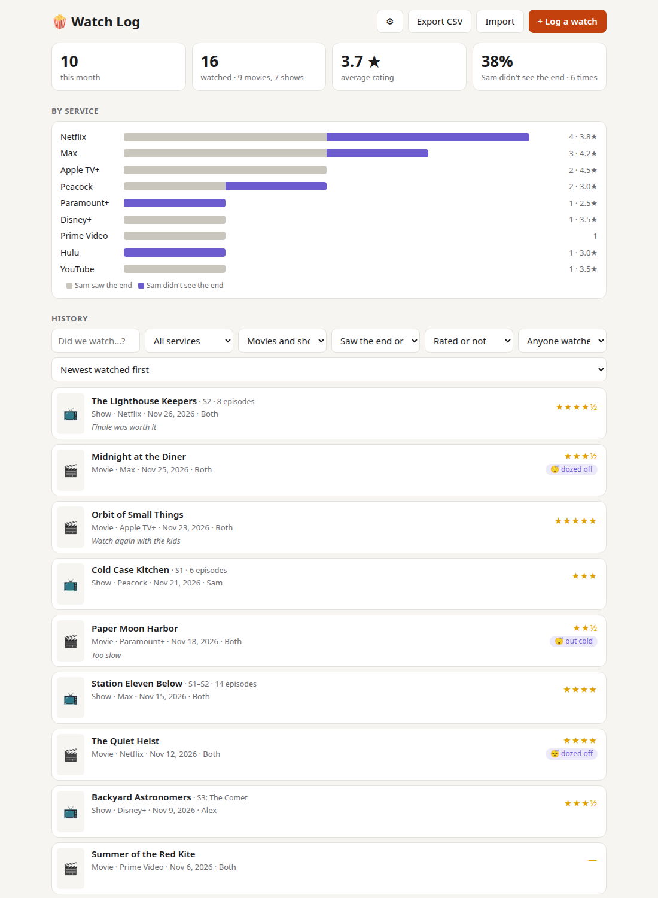

<p align="left">
  <picture>
    <source media="(prefers-color-scheme: dark)" srcset="assets/brand/zs-logo-horizontal-dark-bg.svg">
    
  </picture>
</p>

# Watch log

<picture>
  <source media="(prefers-color-scheme: dark)" srcset="docs/screenshots/overview-dark.png">
  
</picture>

The screenshots use made-up titles from `deploy/demo_data.py`; real watch data stays in the
database on the Pi, which is never committed.

**Dashboard: <http://10.0.0.10:9280>**

A log of the movies and shows we watch on the streaming services: a star rating
(half stars allowed) and whether Person 2 saw the end (saw the end / dozed off / out cold).
The dashboard shows totals, the average rating, how often Person 2 didn't see the end, a per-service
breakdown, and a searchable, filterable history. Tap an entry to edit or delete it.

Entries are typed in by hand: Netflix, Max, Disney+ and the rest have no API for
watch history. Typing a title searches your own past titles, then TVmaze (shows, with
the network or streamer, which fills in the service) and Wikidata (movies). Both are
free and keyless; the Pi does the lookups (`watchlog/lookup.py`) and caches them in memory.

**Netflix import:** on netflix.com, Account → your profile → Viewing activity → Download all,
then use **Import** on the dashboard. It previews the rows (one per show per day by default),
skips anything already logged (same title, day and service), then shows the unrated ones so
you can tap through and rate them. Imported entries start as "saw the end".

Each title is listed once. Pick whose profile a file came from (Person 1 or Person 2); a title in
both profiles becomes "Both". Netflix writes some episodes without a season
("Scrubs: My Last Day"); two or more titles sharing a name are taken as a show's episodes,
with TVmaze deciding nested names ("Star Trek: Prodigy" vs "American Horror Story: Murder House").

Posters are looked up in the background (newest watches first, about one a second) and cached
on disk; a wrong one can be removed from the edit form and won't come back.

Python 3.10 stdlib + SQLite, no dependencies. Same layout as sogdash and netdash.

## Files

| Path | What |
|---|---|
| `watchlog/store.py` | SQLite schema (`watches` table), validation, stats |
| `watchlog/server.py` | HTTP server and JSON API |
| `watchlog/netflix.py` | Netflix viewing-activity CSV parser |
| `watchlog/lookup.py` | title search (TVmaze + Wikidata) |
| `watchlog/posters.py` | poster lookups (Wikipedia, TVmaze), cached in `/var/lib/watchlog/posters` |
| `watchlog/static/index.html` | the dashboard |
| `deploy/watchlog.service` | systemd unit (runs as user `watchlog`, port 9280) |
| `STATUS.md` | where things stand and what is left |
| `SECURITY.md` | security review: no login, what's protected and what isn't |
| `deploy/demo_data.py` | made-up entries for trying it out or screenshots |
| `deploy/sync.sh` | `push` / `backup` / `check` against the Pi |

API: `GET /api/watches`, `GET /api/summary`, `POST /api/watches`,
`PUT /api/watches/<id>`, `DELETE /api/watches/<id>`, `GET /api/search?q=`,
`POST /api/import/netflix` (preview), `POST /api/import` (`{"watches": [...]}`).

## Run locally

```bash
python3 -m unittest discover -s tests -t .
python3 -m watchlog --db /tmp/watchlog.db --port 9280
```

## First-time setup on the Pi (10.0.0.10)

Once, from the laptop (asks for the Pi's sudo password once): creates the `watchlog`
user, copies the code to `/opt/watchlog`, adds the passwordless restart rule, and
enables the service.

```bash
deploy/install.sh
```

The laptop reaches the Pi with `ssh pi` (key `~/.ssh/id_ed25519_pi`, set up 2026-10-27).

After that, `deploy/sync.sh push` deploys changes and `deploy/sync.sh backup`
snapshots the database into `backups/`.

## License

MIT, see [LICENSE](LICENSE). The ZS Tech mark files in `assets/brand/` are not covered by the MIT
License: they are all rights reserved and may be used only to identify ZS Tech (Zachary Spalding Technology Services) and its projects.

---

 A **ZS Tech** project · Zachary Spalding Technology Services · [zspalding12083](https://github.com/zspalding12083). Systems · Networks · Cloud · Open source.
